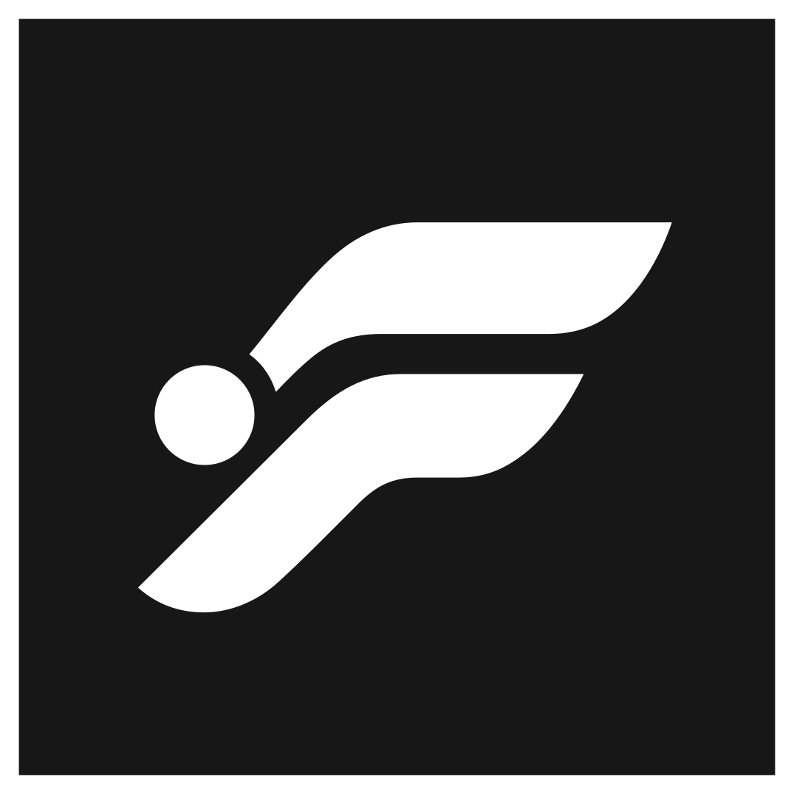
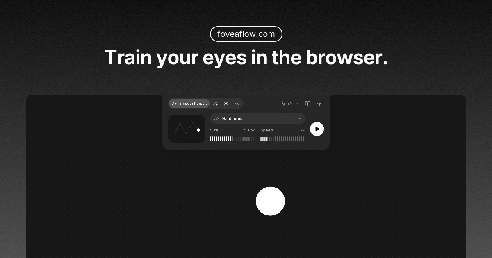

<p align="center">
  
</p>

<h1 align="center">FoveaFlow</h1>

<p align="center">
  Drills for visual tracking, quick refocus, focus under distraction and peripheral awareness.<br />
  Free, no account, settings stay in your browser.
</p>

<p align="center">
  <a href="https://foveaflow.com/"><b>Open FoveaFlow</b></a>
  &nbsp;·&nbsp;
  <a href="https://foveaflow.com/guide/">Guide</a>
</p>

<br />

<a href="https://foveaflow.com/">
  
</a>

## Development

Requires [Bun](https://bun.com/) 1.4.5 and Node.js 26.

```bash
git clone https://github.com/Jesper-N/foveaflow.git && cd foveaflow
bun install
bun run dev        # http://127.0.0.1:4321
```

```bash
bun run build      # static site in dist/
bun run preview    # the build on Wrangler, as in production
bun run fix        # lint fixes and formatting
bun run verify     # everything CI runs
```

Built with [Astro](https://astro.build/), [Svelte 5](https://svelte.dev/), [ui-sdk](https://ui-sdk.dev/) and [Tailwind CSS 4](https://tailwindcss.com/). The drills run on a canvas engine in plain TypeScript.

## Contributing

- Commits run `lint` and pushes run `verify`. `main` deploys to Cloudflare Workers once CI passes.
- Browser tests need Chromium: `bunx playwright install chromium`. They use port 4323, or `TEST_PORT`.
- UI text is keyed by its English wording. Add each new string to all 10 dictionaries in `src/lib/i18n/dictionaries/`.
- A snapshot locks every motion path. When one should change, run `bun test tests/unit --update-snapshots`.
- Tokens, components and motion follow [`docs/design/system.md`](docs/design/system.md).

<br />

<p align="center"><sub>MIT License</sub></p>
